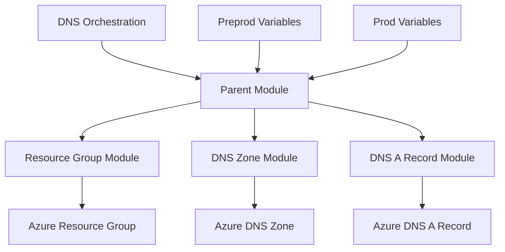

# Terraform Azure DNS Orchestration

Reusable Terraform parent module for managing Azure Resource Groups, DNS Zones, and DNS A Records through a modular Infrastructure as Code approach.

## Architecture

The parent module coordinates three independent child modules:

- **Resource Group Module** — manages Resource Groups.
- **DNS Zone Module** — manages Azure DNS Zones.
- **DNS A Record Module** — manages DNS A Records.

Pre-production and production configurations are maintained separately.



## Repository Structure

```text
terraform-azure-dns-orchestration/
├── main.tf
├── variables.tf
├── providers.tf
├── terraform.tf
├── environments/
│   ├── preprod/
│   │   └── preprod.tfvars
│   └── prod/
│       └── prod.tfvars
└── README.md
```

*Keep this structure aligned with the files actually present in the repository.*

## Implementation Details

- Reusable child modules sourced from GitHub.
- `for_each`-based resource creation where defined in the child modules.
- Environment-specific variable files.
- Parent module dependencies to control provisioning order.
- Azure resources managed through Terraform.

## Prerequisites

- Terraform CLI
- Azure subscription
- Azure authentication configured for the Terraform provider
- Access to the child module repositories

## Usage

Run commands from the parent module root directory.

Initialize Terraform:

```bash
terraform init
```

Validate the configuration:

```bash
terraform validate
```

Preview pre-production changes:

```bash
terraform plan -var-file="environments/preprod/preprod.tfvars"
```

Apply pre-production changes:

```bash
terraform apply -var-file="environments/preprod/preprod.tfvars"
```

For production, use the corresponding `prod.tfvars` file after reviewing the plan.

## State Management

Use separate Terraform state configurations for pre-production and production. Separate variable files alone do not isolate Terraform state.

## Purpose

This repository demonstrates modular Terraform design, dependency management, and environment-specific configuration for Azure DNS infrastructure.
